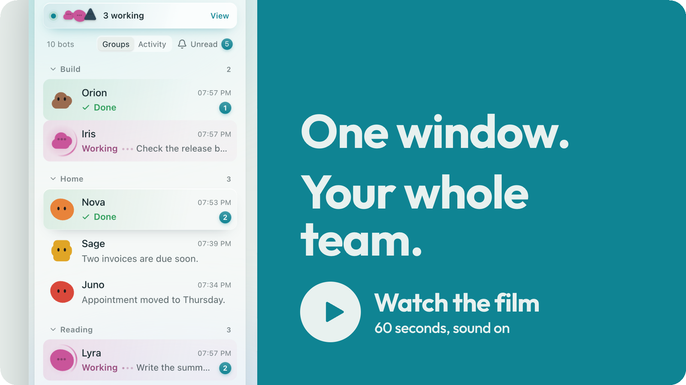
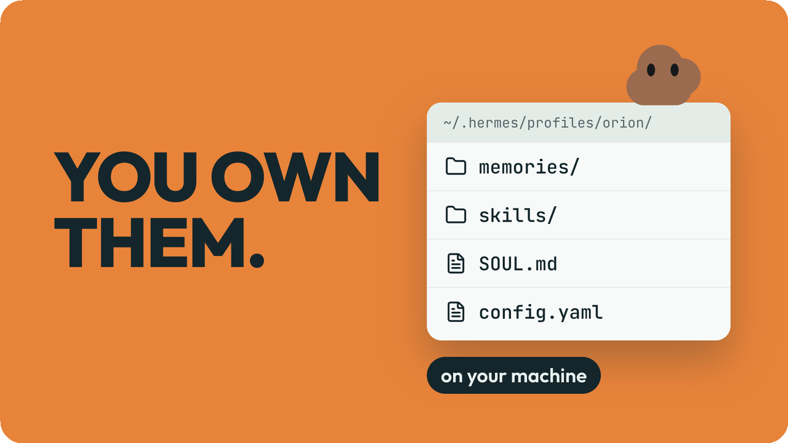
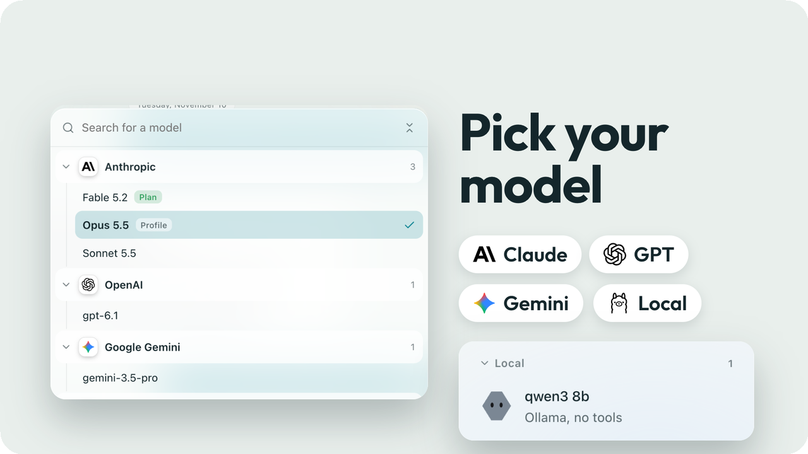
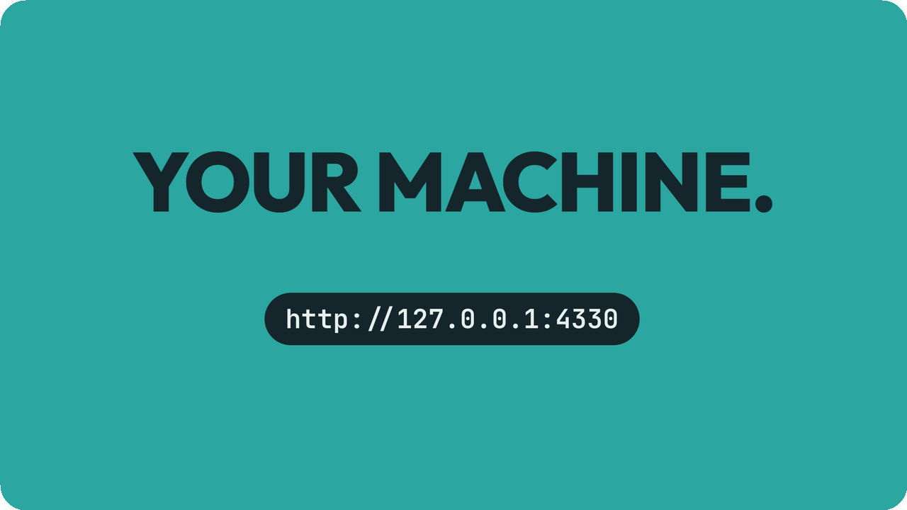
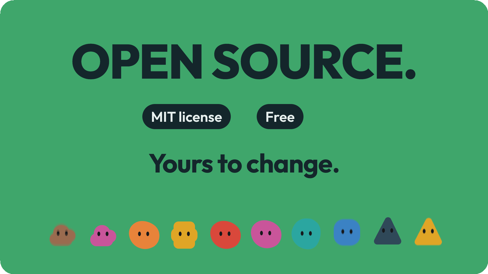
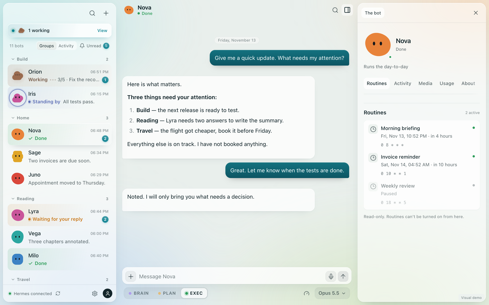
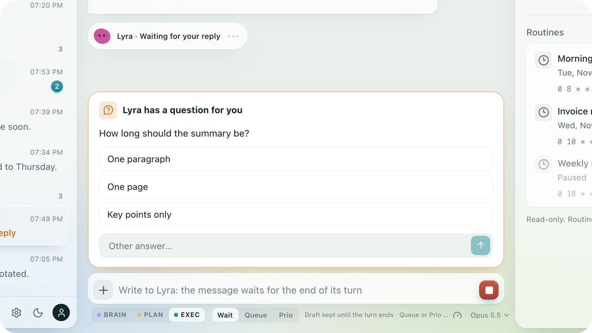

<p align="center">
  
</p>

<p align="center">
  <b>One window for your whole team of <a href="https://github.com/NousResearch/hermes-agent">Hermes Agent</a> bots.</b><br />
  You own them. You pick the model. It runs on your machine.
</p>

<p align="center">
  <a href="#install-with-your-agent">Install with your agent</a> ·
  <a href="#try-it-without-hermes">Try the demo</a> ·
  <a href="#connect-it-to-hermes">Connect it to Hermes</a> ·
  <a href="https://x.com/i/status/2120164337008709910">Watch the film</a>
</p>

<p align="center">
  <a href="https://x.com/i/status/2120164337008709910"></a><br />
  <sub>The film plays on X. The file is also in the repository: <a href="docs/readme/hermesbot-film.mp4">hermesbot-film.mp4</a>.</sub>
</p>

HermesBot is a desktop app for macOS. You see who is working, what each bot is doing and who is waiting for you, and you talk to each bot in its own chat. It is a client: your bots, their tools and their memory stay in Hermes, on your machine.

It is an independent project, not affiliated with Nous Research. Status: early (0.2), used daily by its author. The interface is in English and French.

## Yours, not rented

<table>
  <tr>
    <td width="50%" valign="top">
      <br />
      <b>You own your agents.</b> A bot is a Hermes profile: its memory, its skills and its files live in a folder on your disk. HermesBot is a window on them, nothing more.
    </td>
    <td width="50%" valign="top">
      <br />
      <b>Pick your model.</b> Claude, GPT, Gemini, or a local model on your own GPU: any provider your Hermes is set up with. Change it for one conversation; the bot's profile is never rewritten.
    </td>
  </tr>
  <tr>
    <td width="50%" valign="top">
      <br />
      <b>It runs on your machine.</b> The app's server listens on <code>127.0.0.1</code> only and talks to the Hermes gateway on your machine. Your provider keys stay in Hermes. HermesBot puts no cloud service in between.
    </td>
    <td width="50%" valign="top">
      <br />
      <b>Open source.</b> MIT license. Free. Yours to read and to change.
    </td>
  </tr>
</table>

## One window



<table>
  <tr>
    <td width="50%" valign="top">
      
    </td>
    <td width="50%" valign="top">
      <b>See who needs you.</b> A bot that works is marked "Working", with one line on what it is doing. A bot that asks you something is marked "Waiting for your reply", and its question shows as a card: you answer in one click and it goes back to work.
    </td>
  </tr>
</table>

## Install with your agent

Give this message to an agent that can run shell commands on your Mac, with the address of this page in it:

> Install HermesBot on this Mac. Clone `<address of this repository>` and follow `AGENT-INSTALL.md` at its root, step by step.

[AGENT-INSTALL.md](AGENT-INSTALL.md) is written for the agent. It checks your Mac, builds the app, tries the demo and tells you whether HermesBot can sign in to your Hermes. It asks you before it touches your Hermes or your Applications folder, and it never handles your password.

## Try it without Hermes

You need Node.js 22 or later.

```bash
npm ci
npm run dev
```

Then open http://127.0.0.1:4330/?demo=1. The demo runs on fictional data and makes no network call.

## What it does

- **Roster.** Bots by group, or one list with the most recent activity first. Unread counts, search, a command palette (⌘K).
- **Live status.** A bot that works is marked "Working", with a one-line summary of its current task, built from its to-do list and tool calls without any model call. A bot that asks you something is marked "Waiting for your reply". The status is right even for a bot woken by another bot.
- **Chat.** Streaming, Markdown, tables and code. Stop the current turn. Search in the conversation. Drafts are kept per bot.
- **Questions and approvals.** A question a bot asks in the middle of a turn shows as a card above the input. An action that needs approval opens a dialog (once, for the session, always, deny).
- **Sending while a bot works.** Wait (keeps your draft), Queue (runs after the current turn) or Priority (interrupts, then resumes).
- **Files.** Drag and drop images, videos, PDFs and other files into the chat.
- **Bot media.** Images, galleries, video and audio that a bot sends (`MEDIA:` lines) or cites by path show under its message, with a full-screen viewer. PDF, HTML and Markdown documents open in tabs next to the chat.
- **Bot-to-bot messages.** "Orion messaged Iris" lines in both chats, with the reply. `@bot` mentions tell a bot which other bot you mean.
- **Modes.** BRAIN (think with me), PLAN (write a plan) and EXEC (do it), per bot. BRAIN and PLAN are an instruction for one turn, not a lock on tools.
- **Model picker.** Change the model for one conversation. The bot's profile is never rewritten.
- **Usage.** Context, tokens, cache, calls and speed for the conversation, and 30 days of tokens per day and per model.
- **Routines.** The scheduled jobs of each bot, read-only.
- **Credential prompt.** When a bot needs to log in to a site through the Hermes vault, a dialog asks you for the login or the code. The bot never sees the password.
- **Settings.** Theme, text size, language, send key, hidden bots, which models the picker offers. They stay on your Mac; nothing is written to Hermes profiles.

## Connect it to Hermes

HermesBot needs:

- **Hermes Agent with its gateway Webapp on.** By default the gateway serves it on `http://127.0.0.1:9120`. See "Use the Desktop workspace from a browser" in the Hermes documentation (`hermes config set webapp.enabled true`, then `hermes gateway restart`).
- **A username and password sign-in on that Webapp.** HermesBot signs in with the username and password of Hermes' dashboard sign-in gate (`dashboard.basic_auth` in the Hermes configuration). See "Web Dashboard", section "Authentication", in the Hermes documentation.

> [!IMPORTANT]
> A Webapp left on its default local setup has no password: Hermes signs your browser in with a one-use link. HermesBot cannot sign in to that setup yet. It needs the password sign-in above.

Start HermesBot (`npm run dev`, or the desktop app below), open http://127.0.0.1:4330 and sign in with your Hermes username and password.

Every Hermes profile shows as a bot, except `default` and a profile named `notify`. A profile can carry a card that sets its name, role and group, under `ui_meta["hermes-bots"]`: `title`, `description`, `sectionName` and `sectionId`. Profiles without a card go under "Unassigned".

> [!WARNING]
> Sending a message starts a turn with the model set in the bot's Hermes profile. Depending on your provider, a message can cost money.

### A gateway on another machine

If nothing answers on the gateway address, the desktop app can open an SSH tunnel to the machine that runs Hermes. Set `sshHost` (see Settings) to an SSH host alias that connects without a password prompt. The tunnel forwards port 9120 and closes with the app.

## Desktop app

```bash
npm run desktop    # build, then open the app with Electron
npm run pack       # build release/mac-arm64/HermesBot.app
```

`npm run pack` makes an unsigned app for Apple silicon. An app you build yourself opens normally; one copied from another Mac is quarantined by macOS until you allow it. There is no prebuilt download and no automatic update.

The desktop app keeps your session between launches, encrypted with the macOS Keychain. With "Stay signed in on this Mac" ticked, it also keeps your password the same way, to sign in again when the Hermes session expires. Neither is ever sent back to the window.

## Settings

All settings are optional. Each one is an environment variable, or a key of `config.json` in `~/Library/Application Support/HermesBot/`. [.env.example](.env.example) lists them all.

| Variable | Key in `config.json` | Default | Purpose |
|---|---|---|---|
| `HERMES_ORIGIN` | `gatewayOrigin` | `http://127.0.0.1:9120` | Address of the Hermes gateway |
| `HERMES_BROWSER_ORIGIN` | `browserOrigin` | same as the gateway | `Origin` header sent to the gateway, when it only trusts its public address behind a reverse proxy |
| `HERMES_SSH_HOST` | `sshHost` | none | SSH host alias for the tunnel to a remote gateway |
| `OLLAMA_ORIGIN` | `ollamaOrigin` | `http://127.0.0.1:11434` | Ollama, for the local chat |
| `HERMESBOT_ANIMATIONS` | `animationsDir` | `animations/` in the data folder | Folder of bot animations |
| `PORT` | | `4330` | Port of the local server |

Interface preferences (`ui.defaultBot`, `ui.sectionOrder`, `ui.userInitial`…) only exist in `config.json`.

## Optional extras

- **Local chat.** With [Ollama](https://ollama.com) running, a "Local" entry in the roster chats with a model installed on your machine. You pick the model in Settings > Chats. This chat never goes through Hermes and never gets tools.
- **Bot animations.** Put `<profile>-working.webp` and `<profile>-done.webp` in the animations folder. The bot then plays the first while it works and the second when it finishes. Without them, bots keep a still avatar.
- **Mail approval card.** With the skill in [skills/mail-approval/](skills/mail-approval/), a bot shows an email draft as a card you can edit before it goes out (the skill uses [himalaya](https://github.com/pimalaya/himalaya)). Only the fields you approved are sent; the skill's script refuses a mail that no longer matches them, or the same mail twice.
- **Vault for a shared Chrome.** For bots that drive a Chrome over CDP: a small service (`server/browser-vault/`) keeps site logins in the macOS login keychain and types them into the bot's tab itself, so the password never reaches the bot's context. It needs your own setup (a launchd agent for `server/browser-vault/standalone.mjs`, and the skill in [skills/browser-vault/](skills/browser-vault/)). Read "Security" below before using it.

## How it works

```
window (React)  ──HTTP + WebSocket──▶  local server (Node, 127.0.0.1:4330)  ──▶  Hermes gateway (127.0.0.1:9120)
```

- `src/`: the interface. React 19, TypeScript, Zustand stores in `src/store/`, texts in `src/i18n/locales/{en,fr}/`.
- `server/`: the local server. It signs in to Hermes, keeps Hermes cookies and WebSocket tickets on its side, and relays JSON-RPC (`hermes-gateway-v1`), media and documents. `server/config.cjs` reads the settings.
- `electron/`: the macOS shell. It runs the same server in its main process, keeps sessions in the Keychain and opens the SSH tunnel.
- `tests/e2e.mjs`: an end-to-end run against a fake gateway and a fake Chrome. No model is ever called.
- `skills/`: optional Hermes skills that go with the app.

## Security

- The local server listens on `127.0.0.1` only and rejects requests whose `Host` or `Origin` is not local.
- Hermes cookies and tickets stay in the server process. The window only gets an opaque session id.
- Bot output is treated as hostile. No remote image or resource ever loads. Bot files only pass through the local server, with a fixed content type and no SVG. HTML documents run in a sandboxed iframe with no network and no access to the app.
- HermesBot trusts whatever answers on the gateway address. A local process that took that port would receive your password, but it would already run with your rights.
- HermesBot does not sandbox your bots. They run with the rights of the Hermes gateway's user; use Hermes' own approvals and terminal backends for that.
- The shared-Chrome vault protects against mistakes, not against a hostile bot. Its bots run under the same macOS account as the keychain, so a bot with a terminal could read a saved password or a filled page.

To report a vulnerability, see [SECURITY.md](SECURITY.md).

## Tests

```bash
npm run check      # typecheck and unit tests
npm run test:e2e   # end-to-end run, needs macOS and Google Chrome
```

## Known limits

- Password sign-in only (see "Connect it to Hermes").
- macOS only, and the packaged app is for Apple silicon. The server and the interface may run elsewhere with `npm run dev`, but this is not tested.
- Bots, groups and routines cannot be created or edited from the app yet.
- Most features are verified against the simulated gateway of the test suite and on the author's own setup, not on a wide range of Hermes versions. The gateway contract can change between Hermes releases.
- The SSH tunnel is not restarted by itself when it drops. The reconnect button at the bottom of the roster tries to reopen it.

## Contributing

See [CONTRIBUTING.md](CONTRIBUTING.md). Changes are listed in [CHANGELOG.md](CHANGELOG.md).

## Credits and license

MIT License, see [LICENSE](LICENSE). Third-party work is listed in [THIRD_PARTY_NOTICES.md](THIRD_PARTY_NOTICES.md).

HermesBot is an independent project: it is not affiliated with, endorsed by or connected to Nous Research or any provider named in the app. Some behaviors, such as `MEDIA:` lines and the note added for an `@mention`, follow Hermes Desktop.
